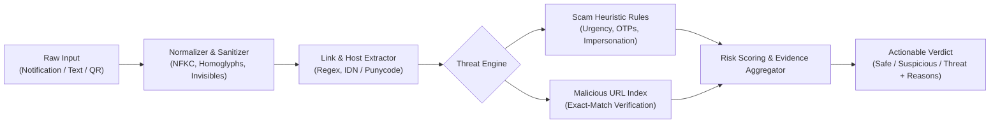

# Sentinel 🛡️
> **100% On-Device, Privacy-First Phishing and Scam Protection for Android**  
> *Developed by Team PhishShield for Code Carnival 3.0*

[-3DDC84?logo=android&logoColor=white)](https://developer.android.com)
[](https://kotlinlang.org)
[](https://developer.android.com/jetpack/compose)
[](#system-architecture)
[-success)](https://developer.android.com)
[](LICENSE)
[](#status--milestones)

---

## 📌 Executive Summary

**Sentinel** is an enterprise-grade, privacy-first mobile security solution designed to protect users against sophisticated social engineering, smishing, WhatsApp/Telegram scams, and malicious QR codes—**entirely on-device with zero internet access**. 

Unlike conventional antivirus solutions that upload message contents to cloud servers for classification, Sentinel guarantees **absolute user privacy** by executing deterministic heuristic analysis, homoglyph detection, and exact-match threat intelligence locally inside an air-gapped security boundary.

---

## 🚀 Key Features

### 1. 🛡️ Real-Time Background Notification Shield
- **Supported Integrations:** Default SMS App, WhatsApp, WhatsApp Business, Gmail, and official Telegram clients (opt-in).
- **Proactive Threat Interception:** Intercepts newly delivered readable notification previews in the background.
- **Safe Notification Replacement:** When a high-risk payload is detected, Sentinel safely suppresses the malicious notification and issues an actionable security warning detailing the threat.
- **Zero Content Tampering:** Sentinel never modifies, reads, or deletes original chats, messages, or emails in the host apps.

### 2. 🔍 On-Demand Manual Text & Link Scanner
- Deep-inspect suspicious text, shortened URLs, or suspicious messages manually via copy-paste.
- Integrates seamlessly with Android’s system-wide **"Share to Sentinel"** intent.
- Provides immediate threat verdicts with exact signal evidence, risk breakdown, and educational explanations.

### 3. 📷 Anti-Phishing QR Scanner (Camera & Gallery)
- Built-in camera scanner and image gallery picker powered by **ZXing**.
- Inspects QR payloads targeting HTTP/HTTPS destinations.
- Enforces a strict security policy: **links are never automatically opened**, neutralizing drive-by exploits.

### 4. 🧠 Transparent Heuristic Engine + Malicious URL Index
- Deterministic, explainable rule engine detecting:
  - **Financial Urgency & Account Takeover:** Impersonation of banking institutions, account suspension alerts, KYC deadlines.
  - **Credential Harvesting & OTP Theft:** Exploitative requests for OTPs, PINs, passwords, and CVVs.
  - **Advance-Fee & Lottery Scams:** Fake job fees, lottery prizes, customs release demands.
  - **URL Obfuscation & Homoglyphs:** Punycode attacks, deceptive subdomains, shortener obfuscation (`bit.ly`, `tinyurl.com`), and IP address hosts.
- **Pre-Indexed Threat Intelligence:** Bundled Kaggle malicious URL dataset index for instant local verification.

### 5. 🔐 Zero-Knowledge Cryptographic Privacy
- **No Internet Access:** Sentinel does not declare `android.permission.INTERNET`. Zero bytes ever leave the device.
- **Keystore-Encrypted Ledger:** Opt-in history stores only high-level metadata (timestamp, risk level, score, rule code). Full message text, URLs, OTPs, and images are **never written to disk**.
- **Automated Rolling Purge:** Records older than 7 days or exceeding a 100-entry ledger are automatically deleted. Full wipe controls available anytime.

---

## 🏗️ System Architecture

Sentinel is architected around clean architecture principles and Android best practices, split across cleanly separated modules:

```mermaid
graph TD
    subgraph UI Layer ["Presentation Layer (Jetpack Compose)"]
        UI[Material 3 UI: Protection / Scan / History / Settings]
        VM[SentinelViewModel / UI StateFlow]
    end

    subgraph Service Layer ["Background Services"]
        NLS[SentinelNotificationListenerService]
        FGS[ProtectionService (Foreground Service)]
    end

    subgraph Data Layer ["Storage & Security"]
        DS[Preferences DataStore]
        KS[Android Keystore Encrypted Ledger]
    end

    subgraph Engine Module [":engine (Pure Kotlin, Platform-Independent)"]
        TE[ThreatEngine]
        UTI[UrlThreatIndex]
        Rules[EnglishScamRules & Homoglyph Normalizer]
        Exp[Explainability & Scoring Pipeline]
    end

    UI --> VM
    VM --> DS
    VM --> KS
    VM --> TE
    NLS --> TE
    NLS --> FGS
    TE --> Rules
    TE --> UTI
    TE --> Exp
```

### Module Breakdown
- **`:app`**: Android UI (Jetpack Compose Material 3), Notification Listener Service, Foreground Protection Service, Camera/ZXing integration, and Keystore encryption.
- **`:engine`**: Standalone, JVM-compatible core detection engine. Zero Android dependencies, enabling rapid deterministic unit testing and CI/CD validation.
- **`:fixture`**: Synthetic attack scenarios, evaluation datasets, and test harnesses.

---

## 🔬 Detection Pipeline



---

## 🛠️ Tech Stack & Engineering Standards

| Area | Technologies / Standards |
|---|---|
| **Language** | Kotlin 1.9.24 / Kotlin 2.0 (100% Kotlin codebase) |
| **UI Framework** | Jetpack Compose, Material 3, Navigation Compose |
| **Architecture** | MVVM + Unidirectional Data Flow (UDF) + Multi-Module |
| **Concurrency** | Kotlin Coroutines & `StateFlow` / `SharedFlow` |
| **Local Persistence** | Jetpack DataStore (Preferences) + Android Keystore (AES-GCM) |
| **QR Engine** | ZXing Core & ZXing Android Embedded |
| **Build System** | Gradle 8.10.2 (Kotlin DSL), Android Gradle Plugin 8.8.0 |
| **Minimum OS** | Android 8.0 Oreo (API Level 26) |
| **Target OS** | Android 15 (API Level 35) |

---

## 📦 Project Structure

```text
sentinel-android/
├── app/                              # Android application module
│   ├── src/main/java/.../
│   │   ├── data/                     # SettingsRepository & Preferences DataStore
│   │   ├── input/                    # QR scanner & Camera activity
│   │   ├── monitor/                  # Notification listener & Foreground service
│   │   └── ui/                       # Jetpack Compose screens, themes, components
│   └── src/androidTest/              # Comprehensive on-device instrumentation tests
├── engine/                           # Pure Kotlin threat detection engine
│   ├── src/main/kotlin/.../
│   │   ├── Analysis.kt               # Threat verdicts, signals & scoring models
│   │   ├── EnglishScamRules.kt       # Deterministic scam heuristics
│   │   ├── ThreatEngine.kt           # Main detection pipeline & coordinator
│   │   └── UrlThreatIndex.kt         # Malicious URL database index
│   └── src/test/kotlin/...           # 40+ deterministic unit tests
├── docs/                             # Engineering specifications & design docs
│   ├── project-overview.md           # Executive hackathon overview & scope
│   ├── detection-hardening.md        # Threat rules, dataset, and heuristics
│   ├── background-protection.md      # Foreground service and battery policy
│   ├── play-protect-appeal.md        # Play Protect security classification
│   └── release-distribution.md       # Universal APK signing & release steps
├── fixture/                          # Test scenarios and mock data
├── build.gradle.kts                  # Root Gradle build script
├── settings.gradle.kts               # Gradle project inclusions
└── README.md                         # Project documentation
```

---

## 💻 Development & Build Setup

### Prerequisites
1. **Java Development Kit:** JDK 17 or JDK 21 (Eclipse Adoptium or Android Studio JBR).
2. **Android SDK:** Platforms 35, Build-Tools 35.0.0, Platform-Tools.
3. **Android Device / Emulator:** Android 8.0 (API 26) or higher.

### Step 1: Clone Repository
```bash
git clone https://github.com/ius-sharma/sentinel-android.git
cd sentinel-android
```

### Step 2: Configure Android SDK Location
Create a `local.properties` file in the project root:
```properties
sdk.dir=C:\\Users\\YOUR_USERNAME\\AppData\\Local\\Android\\Sdk
# On macOS/Linux: sdk.dir=/Users/YOUR_USERNAME/Library/Android/sdk
```

### Step 3: Run Engine Unit Tests
Execute the standalone engine test suite (fast, no emulator required):
```powershell
# Windows
.\gradlew.bat :engine:test

# macOS / Linux
./gradlew :engine:test
```

### Step 4: Assemble Debug or Release APK
```powershell
# Build Debug APK
.\gradlew.bat :app:assembleDebug

# Build Universal Signed Release APK
.\gradlew.bat :app:assembleRelease
```

Generated APKs:
- **Debug:** `app/build/outputs/apk/debug/app-debug.apk`
- **Release:** `app/build/outputs/apk/release/app-release.apk`

---

## 📲 Installation via ADB

To install the built APK directly onto an Android device with USB Debugging enabled:

```powershell
# 1. Verify connected device
adb devices

# 2. Install / Update the APK
adb install -r "app/build/outputs/apk/debug/app-debug.apk"

# 3. Launch Sentinel
adb shell am start -n com.phishshield.sentinel/.MainActivity
```

---

## 🧪 Testing & Verification

Sentinel has been rigorously verified through multiple automated test suites:

- **Engine Unit Tests (`:engine:test`):**
  - Evaluates benign and adversarial payloads.
  - Tests normalization resilience against zero-width characters, homoglyphs, and nested URLs.
  - Verifies exact evidence isolation and boundary handling.
- **Android Instrumentation Tests (`:app:connectedDebugAndroidTest`):**
  - End-to-end Compose navigation and theme persistence.
  - Preference persistence across process restarts.
  - Real ViewModel scan flows, Back handler behavior, and history purging.
- **Hardware Validated:** Successfully tested and verified on real devices including Vivo/iQOO Android 14/15/16 and Samsung Galaxy M-series (Android 14/15).

---

## 🛡️ Privacy & Compliance Guarantees

| Requirement | Sentinel Implementation |
|---|---|
| **Network Isolation** | Zero network calls. `android.permission.INTERNET` is omitted from `AndroidManifest.xml`. |
| **Notification Scope** | Only newly delivered, readable notifications from explicitly enabled apps are processed. Unselected apps are dropped before parsing. |
| **Message Storage** | Scan contents are kept in volatile memory only. Process termination or user clearing immediately purges raw strings. |
| **Encrypted Ledger** | Stored history contains only timestamps, risk scores, and rule categories encrypted with Android Keystore. |
| **User Agency** | Monitoring is off by default. History logging is opt-in. Full history purge available with a single tap. |

---

## 👥 Team PhishShield

Developed with ❤️ for **Code Carnival 3.0**.

- **Project Lead & Core Development:** Team PhishShield
- **Attribution & Acknowledgments:**
  - [Android Open Source Project (AOSP)](https://source.android.com/) for Jetpack and AndroidX libraries.
  - [ZXing Core & ZXing Android Embedded](https://github.com/journeyapps/zxing-android-embedded) under Apache 2.0.
  - Custom neon shield logo supplied by the project owner.

---

## 📄 License

This project is licensed under the [Apache License 2.0](LICENSE).
